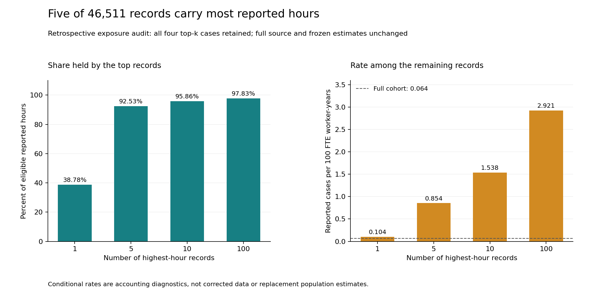

# Reported injury rates depend on exposure

A few reported exposure values can dominate a pooled injury rate and the smoothing built around it. This study keeps those denominators visible in a fixed cohort from OSHA's 2025 establishment summary file.

**Finding:** five of 46,511 eligible records account for **92.53% of reported hours**, while carrying one reported case. The full cohort reports 115,164 cases over 361,383,028,589 hours: a pooled reported rate of 0.063735 per 100 full-time-equivalent worker-years. Independent source parsers agree on the captured values; their agreement does not establish that those values are correct.

## Practical use

Audit exposure concentration before using a pooled reported rate to center smoothing. A rate dashboard should carry cases, reported hours, missingness and the assumptions behind smoothing. Seek source clarification for extreme exposure values before operational use.

The concentration audit is explicitly retrospective: it was added after the frozen comparison exposed the imbalance. All four top-record counts, 1, 5, 10 and 100, are retained. Conditional rates among remaining records are accounting diagnostics, not corrected data or replacement population estimates. No source record, original estimate or prior strength was selected away.

The [implementation exercise](EXERCISE.md) returns two qualified reported-stratum accounts and rejects five unsupported requests, including workplace-safety ranking, legal fault, worker eligibility, future risk and denominator substitution.

~~~powershell
python -m pip install -r requirements.txt
python src/replay.py --out ../injury-rate-replay
python src/check_diagnostics.py
~~~

Use a new output directory. The saved-data replay checks the freeze and source mapping, reproduces six result files, runs independent exact-rational checks and meaningful fixtures, and verifies the actual figures and manuscript. The separate diagnostic checker verifies every retrospective top-k account. Neither command reacquires mutable native data.

## Fixed comparisons and complete evidence

The cohort uses broad manufacturing NAICS prefixes 31, 32 and 33 and reported maximum-size codes for 20-99, 100-249 or unsplit 20-249 employees. Annual average employment is not the size selector. All 46,530 cohort records are retained in source accounts; 19 with nonpositive hours remain outside the eligible rate denominator. Missing values are never filled with zero.

A stated Gamma-Poisson working model centers on the same-cohort pooled rate. Its three authored prior exposures, 0.1, 1 and 10 units of 200,000 hours, are sensitivity probes, not tuned or validated defaults. Against the authored rate > twice-pooled-mean boundary, 0, 2 and 55 records move from above to at/below; none moves upward. That comparison has no regulatory or workplace-safety meaning. No winner or future-accuracy estimate is claimed.

- [Six-page independent manuscript](paper/manuscript.pdf), [LaTeX](paper/main.tex) and three inspected original figures. Not peer reviewed.
- [All nine stratum accounts](results/stratum_accounts.csv), [all 27 stratum/strength accounts](results/sensitivity_accounts.csv), [all 135,204 cell/strength cases](results/cell_sensitivities.csv.gz), [all zero-count bounds](results/zero_count_bounds.csv.gz), [summary](results/summary.json) and [seven requests](results/exercise.json).
- [All four retrospective concentration accounts](results/exposure_concentration.csv), [diagnostic qualification](results/exposure_diagnostic.json), [plan](EXPOSURE_DIAGNOSTIC_PLAN.md) and [independent diagnostic check](results/diagnostic_verification.json).
- [Fixed protocol](PROTOCOL.md), [source meanings](data/README.md), [capture receipt](data/capture_receipt.json), [complete source accounts](data/source_accounts.json), [native verification](data/native_verification.json) and [data rights](DATA_RIGHTS.md).
- Native reconciliation: 445,371 finite conditions across 400,288 rows and every retained source cell. Saved-source checks: 315,540. Complete independent SQLite/Fraction/rounding reconstruction: 1,004,148. Retrospective diagnostic: 40. All 31 authored fixture methods pass.
- Separate full-history CPython [3.10.11](results/reproduction_cpython310.json) and [3.12.14](results/reproduction_cpython312.json) replays reproduce six files byte for byte, with all six source-directory files unchanged in each.
- [Figure verification](figures/verification.json): 62 source-bound bars, 248 actual SVG coordinate conditions, nine asset hashes and 695 finite conditions. [Paper verification](paper/verification.json): 88 used source bindings, complete actual stratum and diagnostic tables, preserved original freeze, unchanged non-writer numerical syntax, current reviewed scope and 415 conditions. All six rendered pages were inspected.

## Timing, assumptions and limits

Only the native header, size and hash were inspected before the numerical protocol was committed. Source values were visible during reconciliation. The [original freeze](HISTORY/PLAN_FREEZE_original.json) bound 21 actual dependencies before comparisons. A [disclosed post-analysis packaging amendment](COMPATIBILITY_NOTE.md) fixes gzip header bytes across Python versions and preserves the original code, freeze and numeric results. Byte-preserving Git checkout fixes an inherited Windows line-ending failure. The failed clone log is retained privately.

The one-sided zero-count Poisson bounds assume a homogeneous independent process. They have no measured interval calibration or workplace-safety validity. Reporting coverage, optional/nonrequired submissions, mixed NAICS versions, extreme reported exposures and unknown physical-establishment identity limit generalization. Current posted values do not establish original submission timing or prediction-time availability.

The [original year-held-out partial-pooling proposal remains unexecuted](ORIGINAL_PROPOSAL.md). There is no protected test, employer safety ranking, future-risk accuracy, new estimator, causal effect, deployment or realized saving in this release.

Raw establishment names, addresses, EINs, identifiers and native files remain private. No case-detail or worker data were requested. Formal-publication projects, including Azure optimization, remain private.

Source: [OSHA ITA Summary Data](https://www.osha.gov/itadata), covering 2025 records submitted January-August 2026, captured 31 October 2026 UTC. Definitions follow the [Summary Data Dictionary](https://www.osha.gov/sites/default/files/summary_data_dictionary.pdf) and [ITA Data Users Guide](https://www.osha.gov/sites/default/files/ITA_data_users_guide.pdf). Reporting does not itself establish fault, violation or benefit eligibility. OSHA does not endorse this independent analysis. MIT covers original code; government facts are attributed separately.
